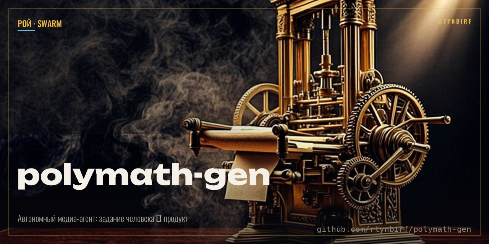
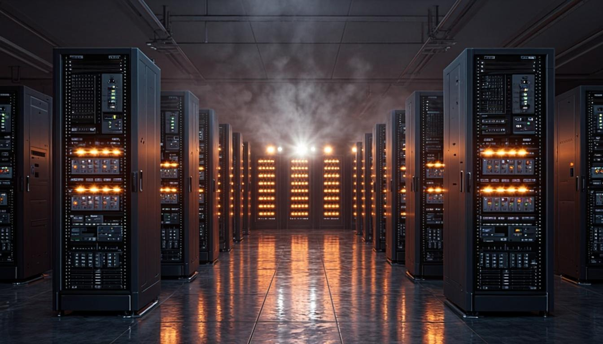
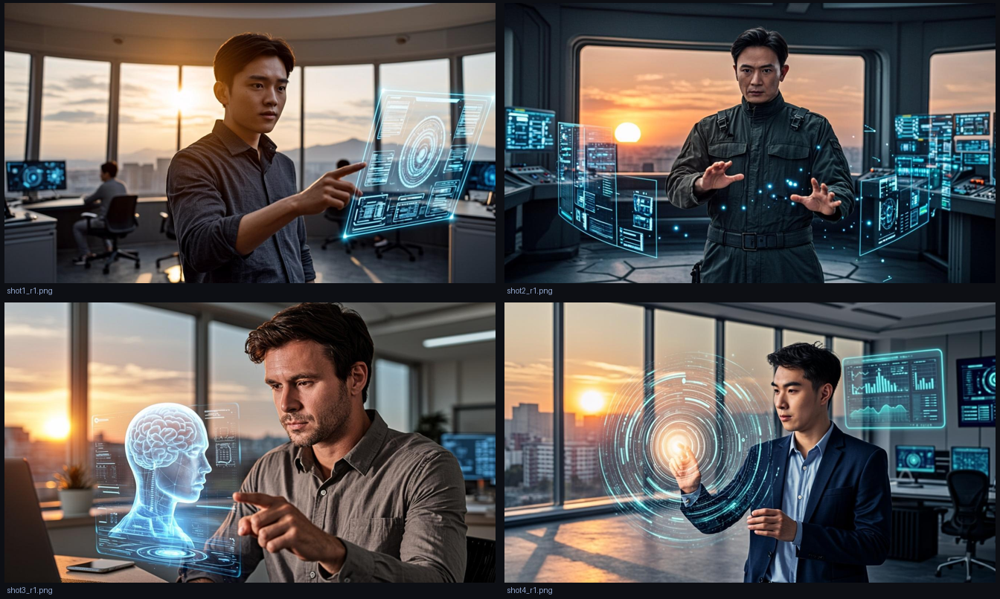

# ПОЛИМАТ-ГЕН 🧠→🎨→👁→✨

<p align="center"></p>


[](LICENSE) [](pyproject.toml) [](tests/) [](polymath_gen/backends/) [](polymath_gen/evolve.py)

**Автономный медиа-агент**: человек ставит задание текстом (по-русски) —
агент сам **планирует кадры → составляет промпты → генерирует изображения и видео →
критикует себя глазами-VLM → дорабатывает → отдаёт результат**.

```
ЗАДАНИЕ ЧЕЛОВЕКА "Ночной дата-центр, ряды GPU, оранжевая подсветка, кинематографично"
   │
   ▼  🧠 МОЗГ (LLM: GLM-облако или Qwen2.5 локально)
   план → промпт EN + negative + LAYOUT-скелет кадра (метод Reve, 8 зон)
   │
   ▼  🖐 РУКИ (z-ai сейчас / ComfyUI+FLUX+SDXL+Wan2.2 локально / A1111)
   картинка 1344x768
   │
   ▼  👁 ГЛАЗА (VLM-критик: GLM-vision / Qwen2.5-VL)
   "5/10 — туман слишком густой, оранжевой подсветки мало"  ← конкретика
   │
   ▼  🔁 Доработка промпта по замечаниям → повторная генерация
   "8/10 ✅ принято"
   │
   ▼  📦 Готово: кадры + контактный лист + видео + полный отчёт state.json
```

## Честно: что сделано и что нет

| Вопрос | Ответ |
|---|---|
| Своя LLM с нуля обучена? | ❌ Нет — в сандбоксе нет GPU-фермы и данных. Мозг подключается готовый: GLM (облако z-ai) **или** Qwen2.5 через Ollama (локально, офлайн). Путь дообучения на своих данных собран: `docs/FINETUNE.md` |
| Генератор изображений? | ✅ Да, работает сейчас (см. демо ниже) |
| Генератор видео? | ✅ Да: t2v/i2v через z-ai + локальный путь Wan 2.2 / LTX-Video / CogVideoX через ComfyUI |
| Инструменты из открытого source загружены? | ✅ Реестр **41 инструмента** `tools/open_source_tools.json` (ComfyUI, FLUX.1-schnell, SDXL, Wan 2.2, ControlNet, IP-Adapter, Real-ESRGAN, kohya_ss, Ollama, Qwen2.5-VL, RIFE, FILM, ffmpeg…) + авто-установщик локального стека |
| Сам составляет промпт по заданию человека? | ✅ Да — это его главная работа (`core/prompt_engine.py`) |
| Сам генерирует нужный человеку результат? | ✅ Да — с самокритикой и доработкой до порога качества |
| Автономно, как ПОЛИМАТ? | ✅ Цикл без человека: план→промпт→генерация→критика→правка→повтор. Память прогонов — `state.json` |

## Живое демо (сгенерировано агентом 08.11.2026)

**Задание:** «Ночной дата-центр: бесконечные ряды стоек с GPU, оранжевая подсветка, лёгкий туман, отражения в тёмном полу, кинематографично»

| Попытка | Оценка критика | Его замечания |
|---|---|---|
| 1 | **5/10** | «Туман как плотное облако дыма; оранжевой подсветки мало — доминируют белые/зелёные LED» |
| 2 | **8/10 ✅** | принято |



Сториборд: 4 кадра по заданию «Инженер-полимат запускает автономный ИИ-агент на закате»
→ видео-монтаж `storyboard.mp4` + контактный лист:



Видео-генерация: `examples/demo_run/20261107_225639/video.mp4` (1920x1080, 5 c, 31 fps).
Полные отчёты с промптами, layout-скелетами и оценками: `examples/demo_run/*/state.json`.

## Быстрый старт

```bash
pip install -r requirements.txt

# 1. картинка с самокритикой (требуется z-ai CLI или --llm ollama)
python -m polymath_gen.cli examples/task.demo.yaml --rounds 2

# 2. раскадровка -> видео-монтаж
python -m polymath_gen.cli examples/task.demo_storyboard.yaml --rounds 1

# 3. генеративное видео (t2v)
python -m polymath_gen.cli examples/task.demo_video.yaml
```

### Полностью офлайн (свой стек, свои модели)

```powershell
# Windows: ComfyUI + SDXL + FLUX.1-schnell + Ollama(Qwen2.5) одной командой
powershell -ExecutionPolicy Bypass -File scripts\install_local_stack.ps1
python -m polymath_gen.cli examples/task.demo.yaml --backend comfy --llm ollama
```
Linux: `scripts/install_local_stack.sh`.

## Бэкенды

| Бэкенд | Что делает | Статус |
|---|---|---|
| `zai` | картинки (7 форматов кадра) + видео t2v/i2v со звуком | ✅ проверено в этом репо |
| `comfy` | локальный ComfyUI: SDXL, FLUX.1-schnell, Wan 2.2, LTX-Video | ✅ адаптер + workflow, требуется локальный сервер |
| `a1111` | локальный A1111/Forge WebUI API | ✅ адаптер, требуется локальный сервер |
| `ffmpeg` | сториборд-монтаж: ключевые кадры → mp4 (xfade+zoompan) | ✅ проверено в этом репо |

## Мозги

| Адаптер | Где | Модели |
|---|---|---|
| `llm/zai.py` | облако | GLM chat + vision |
| `llm/ollama.py` | локально офлайн | Qwen2.5 (мозг) + Qwen2.5-VL (глаза) |

Свой мозг = класс с 4 методами: `.chat() .vision() .available .extract_json()`.

## Самообучение (эволюция)

Агент учится на памяти собственных прогонов:

```bash
python -m polymath_gen.evolve            # собрал runs/*/state.json -> новые правила кодекса
python -m polymath_gen.evolve --dry      # только показать, не писать
```

`evolve.py` находит закономерности в оценках критика («низкие баллы из-за неоранжевого
света», «туман локализован вместо объёмного») и дописывает выученные правила в
`prompts/patterns.json` (раздел `meta.evolution_log`). Промпт-движок автоматически
подхватывает их при следующем прогоне (`_evolved_rules()`). Уже выучено 3 правила:
`dominant_color_rule`, `atmospheric_layering`, `reflection_quality_specification`.

## Знания агента

- `prompts/patterns.json` — кодекс промптинга: distill практик Reve 2.0, Sora, Veo,
  Imagen, Midjourney, SDXL/FLUX. Включая **метод Reve layout→render** (см. `docs/REVE_METHOD.md`).
- `prompts/style_library.json` — 24 стиля (RU → EN).
- `tools/open_source_tools.json` — реестр 41 open-source инструмента с лицензиями.
  Большой атлас: [polymath-tools-atlas](https://github.com/rtynbirf/polymath-tools-atlas).

## Документация

- `docs/ARCHITECTURE.md` — схема организма агента
- `docs/REVE_METHOD.md` — метод layout→render из нашего исследования архива Reve 2.0
- `docs/MODELS.md` — модели с командами скачивания и лицензиями
- `docs/FINETUNE.md` — обучение своей LoRA + prompt-эволюция на памяти прогонов

## Доктрина

1. **Автономия** — человек ставит задачу, агент делает остальное и сам оценивает себя.
2. **Антигаллюцинация** — всё недоступное честно помечается; фоллбеки вместо вранья;
   отчёт каждого прогона (`state.json`) показывает промпты и оценки как есть.
3. **Открытый source** — стек собирается из лучших мировых моделей с чистыми лицензиями.
4. **Память** — каждый прогон артефактен: можно воспроизвести, проанализировать, дообучиться.

## Лицензия

MIT (код). Модели — по своим лицензиям, см. `docs/MODELS.md`.
